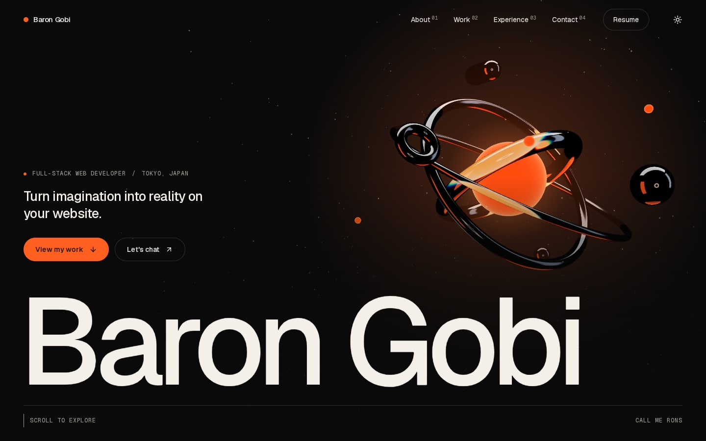

# Baron Gobi · Portfolio

Personal portfolio of Baron Gobi (Rons), a full-stack web developer based in Tokyo.

A dark, editorial site with a 3D hero, scroll-driven motion, case-study pages and a full resume page.



## Features

- **3D hero** built with three.js: an orange core in glass gimbal rings that leans toward the cursor and drifts apart as you scroll. It loads after the page is usable and falls back to a CSS drawing on slow devices.
- **Scroll-driven motion** with Framer Motion: masked text reveals, a quote that lights up word by word, counters, parallax, a velocity-aware ticker and a cursor-following project preview.
- **Dark and light themes** that follow the system setting, with a toggle that remembers the choice and no flash on load.
- **Case-study pages** generated from a single content file, plus a printable resume page.
- **Accessible by default**: reduced-motion support throughout, keyboard-friendly navigation, AA contrast in both themes.
- **Content in one place**: all copy lives in typed files under `src/content/`.

## Tech stack

- [Next.js 16](https://nextjs.org) (App Router, Turbopack) with React 19 and TypeScript
- [Tailwind CSS 4](https://tailwindcss.com)
- [Framer Motion](https://www.framer.com/motion/) for UI motion, [Lenis](https://lenis.darkroom.engineering) for smooth scrolling
- [three.js](https://threejs.org) with React Three Fiber and drei for the hero scene
- [Simple Icons](https://simpleicons.org) and [Lucide](https://lucide.dev) for icons

## Getting started

Requires Node.js 20.9 or newer (`.nvmrc` pins 22).

```bash
npm install
npm run dev
```

Open http://localhost:3000.

## Scripts

| Command                | What it does                       |
| ---------------------- | ---------------------------------- |
| `npm run dev`          | Start the development server       |
| `npm run build`        | Build the production site          |
| `npm run start`        | Serve the production build         |
| `npm run lint`         | Run ESLint                         |
| `npm run typecheck`    | Generate route types and run `tsc` |
| `npm run format`       | Format everything with Prettier    |
| `npm run format:check` | Check formatting without writing   |

## Project structure

```
src/
  app/                 Routes: home, /resume, /work/[slug], 404, sitemap, robots, social card
  components/
    hero/              3D hero scene and its static fallback
    layout/            Header, footer, smooth scroll, theme toggle, back-to-top
    motion/            Reusable animation building blocks (reveal, counter, marquee, ...)
    sections/          Home page sections
    ui/                Small shared pieces (chips, links, accordion, icons)
  content/             All site copy and data
  lib/                 Motion tokens, hooks and helpers
public/                Images and the resume PDF
design-system/         Color, type, layout and motion rules
docs/                  Guides
```

## Documentation

| Guide                                                    | For                                               |
| -------------------------------------------------------- | ------------------------------------------------- |
| [Content guide](docs/content-guide.md)                   | Changing text, projects, jobs, skills and images  |
| [Architecture](docs/architecture.md)                     | How the code is organised and the ideas behind it |
| [Deployment](docs/deployment.md)                         | Deploying to Vercel or another host               |
| [Design system](design-system/baron-portfolio/MASTER.md) | Color, typography, layout and motion rules        |

## Editing content

All text and data live in `src/content/`. Components only read from these files.

| File            | Contains                                           |
| --------------- | -------------------------------------------------- |
| `profile.ts`    | Name, role, tagline, About copy, social links      |
| `projects.ts`   | Projects shown under Work and on `/work/[slug]`    |
| `experience.ts` | Work experience, organizations and education       |
| `skills.ts`     | Technical skills, soft skills and the stack ticker |
| `highlights.ts` | Stats, recognition list and testimonials           |
| `site.ts`       | SEO text and navigation                            |

See the [content guide](docs/content-guide.md) for step-by-step examples.

## Deployment

The site is built for [Vercel](https://vercel.com): import the repository and deploy with the default settings.

Set `NEXT_PUBLIC_SITE_URL` to the public URL (for example `https://example.com`) if you use a custom domain. It is used for canonical links, the sitemap and social cards. On Vercel the production domain is picked up automatically when the variable is not set.

More in the [deployment guide](docs/deployment.md).

## Performance

Lighthouse on the home page, measured locally against a production build:

|         | Performance | Accessibility | Best practices | SEO |
| ------- | ----------- | ------------- | -------------- | --- |
| Desktop | 100         | 100           | 100            | 100 |
| Mobile  | 88          | 100           | 100            | 100 |

The test machine has no GPU, so these runs show the static hero artwork. The live 3D scene only starts on devices with hardware-accelerated WebGL, after the page has loaded.

## Accessibility and motion

- Text contrast is at least 4.5:1 in both themes.
- Visitors who prefer reduced motion get no smooth scrolling, parallax or 3D scene, and content appears in its final state.
- The 3D scene is skipped on data-saver connections, small low-power phones and browsers without hardware-accelerated WebGL 2. A CSS version of the artwork is shown instead.

## Credits

Design direction was informed by three reference sites: the Elena Voss portfolio template, the Kora 3D agency template and the Morrow agency template. All code, the 3D scene and the copy in this repository are original.

Design decisions were guided by the [UI/UX Pro Max](https://github.com/nextlevelbuilder/ui-ux-pro-max-skill) skill.

## License

Code is released under the [MIT License](LICENSE). The personal content (text in `src/content/`, images in `public/images/` and the resume PDF) is not covered and may not be reused.
